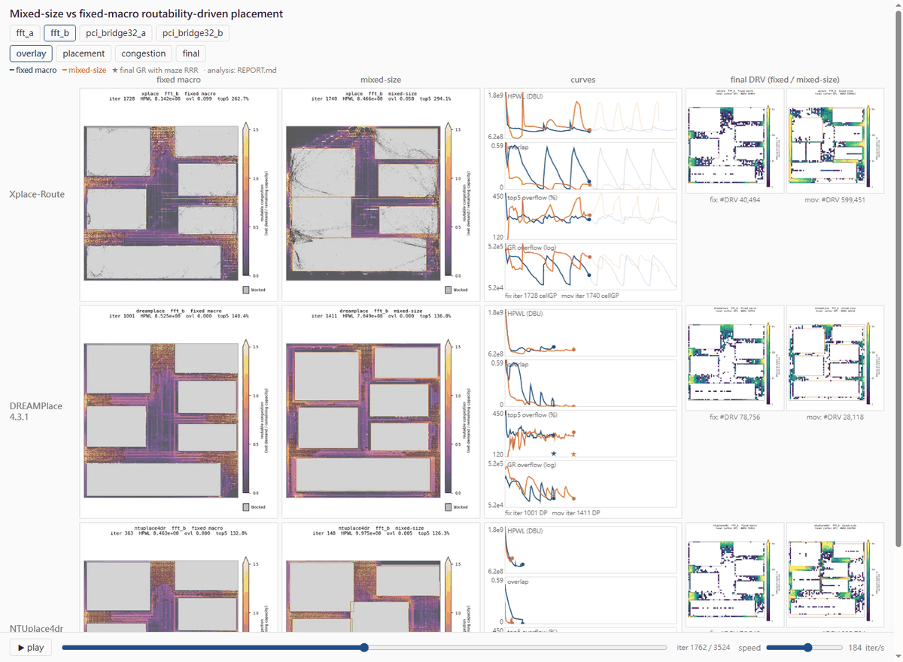
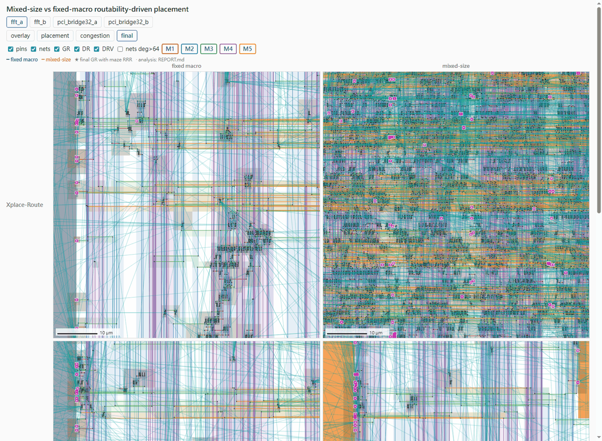
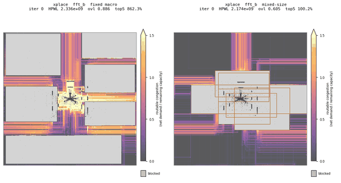
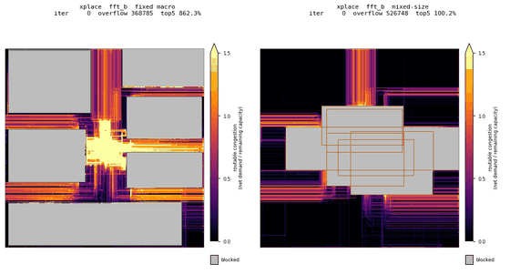
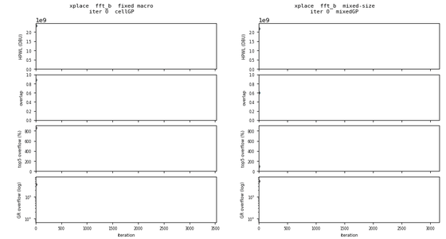
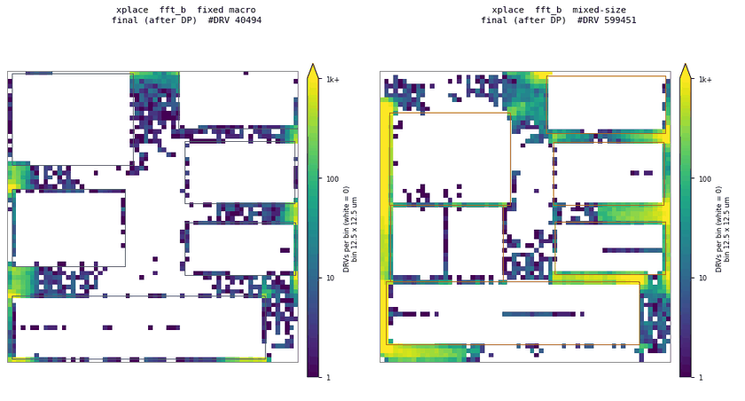

# placeviz

Watch placers work: snapshot, evaluate, route and compare placements on LEF/DEF benchmarks in one web page.

- Any placer, GR and DR, plugged in as shell commands
- Fixed-macro (`fix`) vs mixed-size (`mov`) runs of every benchmark
- Per-snapshot HPWL, overlap, congestion (`rudy` built in, or Xplace GGR on GPU)
- Final routing with DRV maps (CU-GR, Dr.CU + [patch](tools/README.md))
- One `file://` page: play/scrub all runs, curves, zoomable final layout (pins, nets, GR, DR, DRV)
- Resumable: reruns skip finished work; failures are recorded, never stop the batch

## Install

```bash
pip install -e .
```

## Use

1. Copy `config.example.yaml`; fill `placers`, `gr`, `dr`, `benchmarks`, `output` (`no` skips a stage).
2. `placeviz run config.yaml`
3. Open `<output>/web/index.html`.

## Placer contract

- Read `{def}`, write the final placement to `{out_def}`.
- Optional snapshots in `{snap_dir}`: DEF dumps `<iter>[_<stage>].def`, or `placeviz.snapshot.Writer`.
- No placer code ships here. Details: [docs/SNAPSHOT_FORMAT.md](docs/SNAPSHOT_FORMAT.md).

## Example

ISPD2015, Xplace-Route / DREAMPlace / NTUplace4dr, fixed macro (left) vs mixed-size (right).

Overlay tab, mid-run:



Final tab, zoomed, all layers:



`mgc_fft_b`, Xplace-Route:

| overlay | congestion | curves |
|---|---|---|
|  |  |  |

Final DRV: 40,494 (fixed) vs 599,451 (mixed-size).



## License

[MIT](LICENSE). `tools/drcu_vio_dump.patch`: CU-SD (see [tools/README.md](tools/README.md)).
